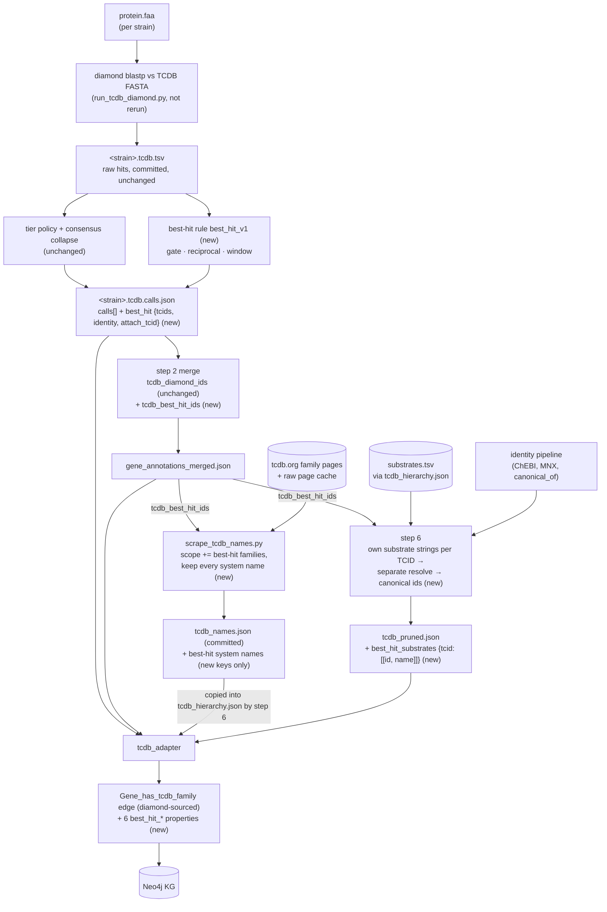

# TCDB diamond best-hit details — design

**Date:** 2026-10-18 · **Status:** draft for review · **Project 2 of the transport programme**
(programme framing: `2026-10-18-go-transport-substrates-design.md` §1; slice 1 merged c52c3580)

## 1. Why

`/tcdb-diamond` blasts every protein against TCDB, then the tier policy plus per-family
consensus collapse truncates the call to the depth the evidence "justifies" — usually
`tc_family` (tier 3). The KG keeps only that truncated id. Through
`Tcdb_family_transports_metabolite` (pre-rolled up over the full subtree) a tier-3 call
reads as every substrate of every system in the family: up to ~500 substrates per gene
(`3.A.1` = 554).

The protein's **actual best-hit system** — the curated 5-part TCDB system it most
resembles — is computed and then thrown away. It is not in the KG, so no consumer can
recover it. Example: MED4 `cynD` (PMM0372) is called `tcdb:3.A.1`; its best hit is
`3.A.1.16.2` (cyanate) at 59% identity, 95% query coverage.

This project keeps that one clue. It does **not** decide what a gene transports; it adds
the best hit as one more route, with its caveat, beside eggNOG TC, KEGG BRITE
transporters, Pfam/InterPro domains, Cyanorak roles and GO transport (slice 1). The
reader (an LLM agent via the explorer) weighs routes; the final call stays in the
analysis.

Motivating use (evaluation only, not solved here): "which transporters does this genome
have for nitrogen sources, and what are their substrates or substrate classes"
(ammonium, urea, cyanate vs nitrate/nitrite, amino acids, peptides…).

## 2. Goals, non-goals, anti-goals

**Goals**
- Publish each diamond call's gated best-hit TCDB system(s) and their own substrates,
  on the existing diamond-sourced `Gene_has_tcdb_family` edge.
- Smallest form that survives the project-3 TCDB redesign: six edge properties (ids +
  aligned names, so the record reads without joins), no new node or edge types, no new
  Metabolite nodes.
- Cheap validation against transport evidence already in the KG.

**Non-goals (deferred)**
- A per-gene `Gene → Metabolite` transport edge (after project 3).
- Substrate-class fallback for ambiguous/low-identity calls (derivable later from what is
  stored here).
- Grouping subunits into systems; transport direction.
- Changing tier / consensus / `tcdb_family` attachment, `substrate_depth`,
  `substrate_breadth`, `transport_substrate_resolution`, or any rollup. Project 3 owns these.
- Answering the nitrogen question.

**Anti-goals**
- Storing raw diamond hits (no hit tables, no runner-up scores, no qcov/scov/bitscore per hit).
  (The substrate lists are unfiltered — raw material. What the rule itself excludes — gate,
  reciprocal check, window cap of 3 — is the definition of a best hit, not a filter.)
- Hand-picked TC-family exclusion lists derived from the genes we inspected (overfitting).
- A fused "confidence" flag that hides the evidence (programme rule: routes with caveats).
- Tuning thresholds on the evaluation strains.

## 3. The rule (frozen before evaluation)

Input: the committed per-strain diamond table
`cache/data/<org>/genomes/<strain>/tcdb/<strain>.tcdb.tsv` (columns: qid, subject
`lcl|<acc>-<TCID>`, identity, qcov, scov, length, evalue, bitscore; `--max-target-seqs 25`,
`--evalue 0.001`, `--more-sensitive`). No new diamond run.

For each protein:

1. **Hit gate.** Keep hits with qcov ≥ 75 **and** scov ≥ 75, and TC class ∈ {1, 2, 3, 4}.
   - qcov ≥ 75: measured on MED4 2026-10-18 (hit covers most of our protein).
   - scov ≥ 75: gapseq's reference-coverage rule (`src/transporter.sh`, jotech/gapseq
     master 2dce3a0: TCDB is the blast *query*, `-qcov_hsp_perc 75`, i.e. coverage of the
     reference). Rejects single-shared-domain hits.
   - Classes 1–4: gapseq's `TC_types` (5, 6, 8, 9 ignored: electron carriers,
     accessory/incompletely characterized).
   - gapseq's bitscore 200 is **not** adopted (length-biased: on MED4 it drops 26
     proteins with ≥ 50% identity); no identity floor (identity is published instead).
   - Subject format is `lcl|<acc>-<TCID>`; reuse `parse_tcdb_subject_id`. One TCDB
     reference carries a 6-part id (`lcl|Q39253-1.A.1.9.2.3`, 6 of 261,292 rows
     corpus-wide); truncate any id longer than 5 parts to its first 5 (`1.A.1.9.2`, a
     curated system with substrates). The parser must accept it rather than reject it.
2. **Reciprocal best hit.** The protein's top-bitscore gated hit `X` (a subject row) must
   also be `X`'s top-bitscore hit among this strain's **gated** rows (same table, grouped
   by subject; a partial-coverage paralog is not a competitor). Fails → no best-hit
   details for this protein. Standard ortholog-vs-paralog test, no parameter. Approximate
   because the forward run keeps 25 targets per protein; the error leans toward passing.
   Unit = query id (WP_ accession): identical protein copies share one WP_ and therefore
   one result, applied to each of their genes. Ties (my call): order by bitscore desc,
   then TCID / query id ascending — deterministic, no biological meaning.
3. **Window.** Keep gated hits with bitscore ≥ 0.9 × top bitscore, up to 3, best first,
   distinct 5-part TCIDs (a TCID appearing twice keeps its best row), **from any TC
   family** (user, 2026-10-18). Cross-family near-ties are 244 of 12,379 proteins (2%),
   mostly one protein curated as a component of systems in two families (3.D.3 + 3.E.2
   b6f/reaction centre 70; 1.B.42 + 3.A.1 Lpt export 63; 3.A.11 + 3.A.15 22) — real
   information, not competing guesses.
4. **Attach.** The top hit decides the edge: the record goes on the protein's
   diamond-sourced `Gene_has_tcdb_family` edge in the top hit's 3-part family. Measured
   2026-10-19: every best-hit protein that has any diamond call has one in the top hit's
   family (0 exceptions), and exactly one per family (calls are per family). A gene can
   have several diamond edges (6,752 of 29,642 proteins); the record sits on exactly one.
   Defensive fallback (expected never to fire; logged): the protein's highest-confidence
   call. Window ids after the first may fall outside the edge's TC id (cross-family
   window); consumers must not assume they don't.
   - **188 best-hit proteins have no diamond call at all** (top-hit HSP < 50 aa, below the
     tier policy's length floor — small photosystem / complex subunits, e.g. Alteromonas
     `WP_012519975.1` → `3.D.4.3.2`, 29 aa). They have no `Gene_has_tcdb_family` edge to
     carry the record, and creating one would change the existing edge set. Their record
     is kept in calls.json and in the merge field `tcdb_best_hit_ids` (so project 3 has
     it), but not on a KG edge (my call, 2026-10-19 spec review; flagged to the user).

The rule is frozen; the counts below are re-measured by the plan's first task from a
committed script implementing exactly this text, and that output becomes the reference.

Effect measured 2026-10-18 (exploratory, gate as above):
- MED4: 180 proteins pass the gate, 163 pass the reciprocal check, 46 of those carry more
  than one window TCID. The 17 failures are
  mostly non-transporters (clpB, dnaK, ftsH, gap3 hitting protein-import/secretion
  systems), photosystem paralogs (pcb, ndhD2) and ABC paralogs borrowing a sibling's
  substrate (sufC, PMM1029/1031, modF). cyn/urt/amt1/dpp/ktrA keep their calls.
- 43 strains: 15,372 proteins pass the gate, 12,379 the reciprocal check (12,191 with a
  diamond call → edge record; 188 without, see step 4), naming 1,993 distinct 5-part
  systems (203 already TcdbFamily nodes). Re-implemented independently in the spec
  review with the same counts.
- 529 of the 1,993 systems (27%) have no substrates in TCDB, so many edges will carry
  `best_hit_tcids` without the substrate lists.

### Relation to the tier policy

Tier expresses uncertainty by truncating depth (weak hit → shallower claim); the
best-hit record keeps full depth and publishes identity + near-ties instead. The gate is
stricter on coverage (both sides ≥ 75 vs tier 1/2's qcov ≥ 70/60 and tier 3's qcov **or**
scov ≥ 40) and on paralogs (reciprocal), looser on identity (none). Exploratory overlap
over 43 strains, per diamond call, best hit in the same 3-part family:

| Edge tier | Calls | With details | Reciprocal fail | Coverage/class fail | Best-hit identity median (p10–p90) |
|---|---|---|---|---|---|
| 1 | 192 | 138 | 3 | 51 | 74 (70–96) |
| 2 | 6,693 | 3,271 | 359 | 3,063 | 53 (42–74) |
| 3 | 34,277 | 8,782 | 2,630 | 22,865 | 37 (26–67) |

All 138 tier-1 details name the tier call's own system; all 3,271 tier-2 details fall
inside the called subfamily. The new information is on tier 3 (776 at ≥ 70% identity,
demoted by consensus; 5,292 below 40%). 864 tier-2 and 2,505 tier-3 calls carry more than
one window system. Tier-1 calls failing the gate get no details — no exception (user,
2026-10-18).

## 4. What is stored

On the diamond-sourced `Gene_has_tcdb_family` edge (sparse; absent when the rule yields
nothing):

| Property | Type | Content |
|---|---|---|
| `best_hit_tcids` | str[] (1–3) | Window 5-part TCIDs, best bitscore first. Plain TCDB ids (`3.A.1.16.2`), not node ids — these systems are generally not KG nodes. |
| `best_hit_names` | str[] | Aligned index-for-index with `best_hit_tcids`: TCDB system name from `tcdb_names.json` (e.g. `3.A.1.16.2` → "Bispecific cyanate/nitrite transporter."); falls back to the TCID itself when unnamed (same marker as `TcdbFamily.name = tcdb_id`). |
| `best_hit_identity` | float | Percent identity of the top hit. |
| `best_hit_substrate_tcids` | str[] | Long form, one entry per (window system, substrate) pair: the system the substrate belongs to. Aligned index-for-index with the two lists below; ordered by window rank, then substrate id. A substrate two systems share appears once per system; a system with no substrates has no entries. |
| `best_hit_substrate_ids` | str[] | Aligned with `best_hit_substrate_tcids`: that system's own substrate (`substrates.tsv` row for the TCID), resolved like every TCDB substrate in step 6 (secondary → primary ChEBI, KEGG/ChEBI/MNX canonicalisation, role partition) to a canonical Metabolite / ChemicalRole id. **Unfiltered and kept whether or not a node exists** (user, 2026-10-18: raw material for project 3): H⁺, Na⁺, upper-level classes and polymers (protein, DNA) stay in; an id the resolver cannot canonicalise is stored as its primary `chebi:` CURIE. |
| `best_hit_substrate_names` | str[] | Aligned with the two lists above: the canonical node's name when the node exists, else the name TCDB gives with the ChEBI id in `substrates.tsv`. |

Layout (user, 2026-10-19): the substrate lists are a long table, not a union, so the
reader can tell which system names which substrate — the point of a split call (MED4
`sul1`: one system → sulfate, the other → fumarate). Neo4j has no nested lists, so this is
the flat form; it can change when the design matures (project 3).

Read together: one TCID = clean call; several = near-tie, and the reader checks whether
their substrates agree (e.g. MED4 `sul1`: fumarate vs sulfate → genuinely ambiguous, not
"transports both"). Identity says how far the substrate transfer can be trusted (rough
literature guide: ≥ ~50–60% fairly safe, < ~40% weak).

Absent substrate lists mean TCDB lists no substrate for any window system (27% of
best-hit systems). Because nothing is filtered, consumers must expect H⁺,
Na⁺, generic classes and polymers among the ids; filtering (e.g. slice 1's
`go_transport_target_filter.yaml`) is a reading choice, stated in the kg-changes caveat.

Sanitization: every string element of the five list properties passes through the
adapter's `_clean_str` (`'` → `^`, `|` removed); seven best-hit substrate names contain
`'` (e.g. `N,N'-diacetylchitobiose`). No list element is ever empty: system names fall back
to the TCID, substrate names to the id.

Not to be confused with MEROPS: `Gene_has_merops_family.best_hit_id` / `best_hit_kind` are
a single hit's id and kind; TCDB `best_hit_tcids` is a window of up to three systems. The
kg-changes caveat says so.

Note: the existing edge `identity` / `qcov` come from the highest-identity hit in the
consensus family group, pre-gate; `best_hit_identity` is the gated top-bitscore hit. They
usually coincide; both stay.

**No new Metabolite nodes, no dangling edges.** The ids live in a property, not in
edges, so an id without a node cannot break import. Most will match emitted nodes anyway
(the top hit descends from a kept TC family whose node carries the full-subtree substrate
rollup; 0 gated TCIDs were missing from the step-6 hierarchy on 2026-10-18). Validation
reports how many stored ids have no node.

## 5. Where it is computed (my call; builder may adjust)

- **Phase-1 artifact:** the runner adds a per-protein `best_hit` block to
  `<strain>.tcdb.calls.json` (`rule`, `tcids`, `identity`, `attach_tcid`; `attach_tcid`
  absent for the 188 call-less proteins, whose record is `{"calls": [], "best_hit": …}`),
  derived from the hit table `build_strain_calls` already parses. Produced with a new
  `--from-tsv` mode that rebuilds calls.json from the **committed** `.tcdb.tsv` without
  running diamond (spec review 2026-10-19: a `--force` rerun overwrites the TSV and, on a
  machine whose TCDB FASTA differs from the one behind the committed TSVs, changes the
  existing tier calls). A real diamond rerun stays allowed (user, 2026-10-18) but is not
  needed. Acceptance: every strain's `calls[]` byte-identical before and after. Diamond
  parameters unchanged. Rule lives in one function with unit tests.
- **Step 6:** collects all best-hit TCIDs across strains, resolves their own substrates
  through the existing substrate resolver, and writes `best_hit_substrates:
  {tcid5: [[canonical_id, name], …]}` into `tcdb_pruned.json` (unfiltered, §4; `name` = the
  node's name when the id is a node, else the TCDB-given name). Canonical ids exist only
  after the step-6 identity pipeline, so the map is written from there, not where
  `subtree_substrates` is first built.
  - The best-hit resolve uses its **own fresh `rekeys` dict**: `_resolve_substrate_strings`
    mutates the dict passed in, and the main one feeds `Step6Inputs.rekeys` and the remap.
  - It runs **tracked** (my call): ChEBI terms it touches join the committed
    `cache/data/chebi/chebi_metabolite_xrefs.json` (~1K more ids), so step 6 stays
    reproducible from committed files on a machine without raw `chebi.obo`. Expected to
    change that file; `kegg_data.json` and every existing `tcdb_pruned.json` key must stay
    byte-identical.
- **Why a separate key, not added to `kept_tcdb_ids` (user, 2026-10-19):** keeping the
  ~1,790 best-hit systems as pruned nodes would roughly double TcdbFamily with gene-less
  nodes, add thousands of `Tcdb_family_transports_metabolite` edges, flip existing edges'
  `substrate_depth` to `inherited`, shift `Metabolite.transporter_count`, and possibly add
  Metabolite / pathway nodes — a TCDB-layer redesign that belongs to project 3. The
  separate `best_hit_substrates` key is read only by the adapter; promoting it to nodes
  later is mechanical.
- **TCDB names:** `scrape_tcdb_names.py` scope becomes kept ids ∪ best-hit TCIDs (251
  families: 198 already scraped, 53 new). It **adds** names for best-hit 5-part systems
  and leaves every existing `tcdb_names.json` entry verbatim (merge-preserving
  `assemble_names`; acceptance: existing keys byte-identical), so current TCDB wording
  cannot change existing `TcdbFamily.name` / `description`. The raw page cache
  (`cache/data/tcdb/raw/pages/`, gitignored) lives only in the other clone
  (`multiomics_biocypher_kg`); copy it over before running so the 198 scraped families
  are re-parsed, not re-fetched — only the 53 new pages hit tcdb.org (~2–3 min).
  `--families` top-ups merge instead of rewriting (pre-existing bug, fixed here).
  `tcdb_names.json` stays committed. The adapter gets system names via
  `tcdb_hierarchy.json`; step 6 warns on best-hit systems still unnamed.
- **Adapter:** `tcdb_adapter` reads `best_hit` from calls.json (already reads calls.json
  for evidence), system names from `tcdb_hierarchy.json` (step 6 copies them in from `tcdb_names.json`) and `best_hit_substrates` from
  `tcdb_pruned.json`, and attaches the six properties per §3 step 4. The seed-alias edge
  merge must carry `best_hit_*` from whichever side has them.
- **Schema:** BioCypher writes only declared edge properties — add the six to
  `gene_has_tcdb_family` in `config/schema_config.yaml` (`str[]` ×5, `float` ×1). The merge
  field `tcdb_best_hit_ids` is **not** declared on Gene (no new Gene property).
- **Merge (step 2, user 2026-10-19):** one light field, `tcdb_best_hit_ids` (str[], window
  order), from the `tcdb_diamond` source — the per-gene source of truth for project 3,
  including the 188 call-less proteins (the loader must not skip proteins with an empty
  `calls` list).
  Not part of `transporter_classification` (never seeds pruning or creates edges). Identity
  and `attach_tcid` stay in calls.json (per-call evidence, interpro/tcdb pattern). Step 6
  and the name scraper read best-hit TCIDs from this field. Text fields
  (`alternate_functional_descriptions`, full-text search) are not touched — a follow-up.

Vocabulary/contract: register the six properties in `config/controlled_vocabularies.yaml`
(TCDB edge numerics already are: `identity`, `qcov`, `evalue`, `consensus_n`). Expected
consequence: `Schema_info.controlled_vocabularies_hash` moves and six `ControlledVocabulary`
nodes are added — allowed by the "nothing existing changes" acceptance.

**Committed files expected to change:** 43 × `.tcdb.calls.json` (+ `skill_summary.json`),
43 × `gene_annotations_merged.json` and `gene_annotations_wide.json` (new key only),
`tcdb_names.json` (new keys only), `tcdb_hierarchy.json` (non-kept specificity entries gain
the scraped name/description; kept entries unchanged), `tcdb_pruned.json` (new key only),
`chebi_metabolite_xrefs.json` (more terms). Not: `.tcdb.tsv`, `kegg_data.json`, any other
step-6 output. KG-side, besides the six properties: the vocabulary hash, six
`ControlledVocabulary` nodes, and `data_source:tcdb_diamond.info_types` (+`tcdb_best_hit_ids`).
System names reach the adapter through `tcdb_hierarchy.json`, which step 6 already fills
from `tcdb_names.json`.

### Data flow

New pieces are marked **(new)**; everything else exists today and is unchanged.

| Stage | Reads | Writes | What it contributes |
|---|---|---|---|
| Diamond runner, `--from-tsv` | committed `.tcdb.tsv` | `.tcdb.calls.json` | Per protein: `best_hit.tcids` (≤ 3), `best_hit.identity`, `best_hit.attach_tcid` (which of its calls carries the record; absent when it has no call), `best_hit.rule`; `calls[]` byte-identical |
| Name scraper | merged `tcdb_best_hit_ids`, page cache, tcdb.org (53 new pages) | `tcdb_names.json` | Names for best-hit systems as new keys (≥ 95% target; else the TCID is the name); existing keys verbatim |
| Step 6 | merged `tcdb_best_hit_ids`, hierarchy substrate strings, ChEBI/MNX, identity pipeline | `tcdb_pruned.json` `best_hit_substrates` | Per system: its own substrates as `[canonical id, name]`, unfiltered, nodes not required. Separate resolve with its own `rekeys`, tracked (ChEBI cache grows); `kegg_data.json` and every existing key byte-identical |
| Step 2 merge | calls.json | merged annotations | Edge set unchanged (`transporter_classification`); adds per-gene `tcdb_best_hit_ids` |
| `tcdb_adapter` | calls.json, merged annotations, `tcdb_hierarchy.json` (names), `tcdb_pruned.json` | `Gene_has_tcdb_family` edges | Strain adapter puts `best_hit_tcids` + `best_hit_identity` on the edge whose TC id = `attach_tcid`; Multi adapter adds `best_hit_names` and the three long-form substrate lists, and carries `best_hit_*` through the seed-alias edge merge |

Rerun order after a change: diamond runner (`--from-tsv`, or a full run when TCDB itself is
refreshed) → `prepare_data.sh --steps 2 --force` → name
scraper (only if new best-hit families) → `prepare_data.sh --steps 6 --force` → KG rebuild. Step 6 warns when
best-hit systems are unnamed.

## 6. Validation (light; existing sources; no tuning)

Rule frozen as §3 before running. MED4 is training data; report on hold-out strains
(e.g. MIT9313, WH8102, HOT1A3, KT2440, DSS-3) and corpus-wide. One throwaway-quality
script (kept under `scripts/` or the plan's scratch), output summarized in the kg-changes doc.

Per gene with best-hit details, measure agreement / inclusion with:
1. **eggNOG TC** — best-hit TCID equal to, descendant of, or ancestor of eggNOG's TC id;
   or contradicting (different family).
2. **KEGG BRITE transporters** (`ko02000` via `Kegg_term_in_brite_category`) — gene's KO
   is a transporter; where the KO name states a substrate, does it overlap.
3. **Domains** — best-hit 3-part family bridges (`Tcdb_family_has_pfam_domain`) to a Pfam
   the gene carries.
4. **Cyanorak role** — gene in a transport role (Pro/Syn).
5. **GO transport (slice 1)** — gene→GO→Metabolite substrates overlap
   `best_hit_substrate_ids` (same / related / disjoint).
6. **Nitrogen sanity table** (a few strains, e.g. MED4, MIT9313, WH8102, one Alteromonas):
   for N-source genes, best-hit substrates vs today's tier-rollup substrate count.

Report also: genes gaining details, reciprocal-check failures by category, split calls
(window members with disjoint substrates), fallback attachments, stored substrate ids with
no node, and how many would be removed by slice 1's target filter. Disagreements:
random sample (~30), classified rule-wrong / comparator-wrong / unclear. If anything tempts
a threshold change, re-evaluate on fresh strains. Comparators are correlated (shared
homology), so agreement is an upper bound.

**Acceptance:** every best-hit protein *with a diamond call* has its record on exactly one of its gene's diamond edges in a live rebuild; the 188 call-less ones appear in `tcdb_best_hit_ids` only; cynA/cynD →
cyanate system ("Bispecific cyanate/nitrite transporter."), amt1 → ammonium, urt → urea on
MED4; ≥ 95% of stored best-hit TCIDs carry a real name (not the id fallback); validation table recorded;
`pytest -m "not slow and not kg"` and `pytest -m kg` green; no existing edge/property
changes beyond the expected-files list in §5 (`/omics-edge-snapshot`, TCDB node/edge and Metabolite counts unchanged; only the vocabulary hash and six new `ControlledVocabulary` nodes move).

## 7. Documentation

kg-changes doc (`docs/kg-changes/tcdb-diamond-best-hit.md`) with the caveat paragraph for
the explorer; CLAUDE.md TCDB bullet; tcdb-diamond SKILL.md (artifact schema); CHANGELOG
`### Added`; backlog transport section.

## 8. Left to the builder

Exact function boundaries, test fixtures, the `--from-tsv` flag name, whether the
`best_hit` block also records the gated top hit's qcov/scov for audit in the artifact
(artifact only, never the KG), log wording.
